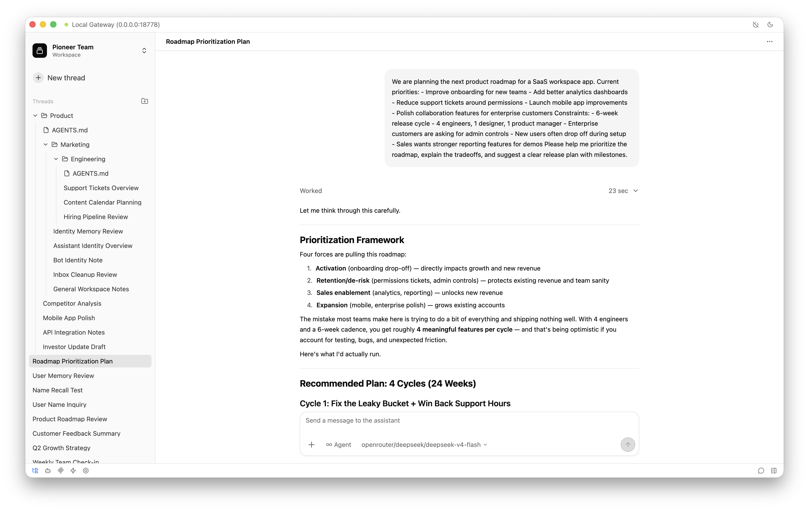
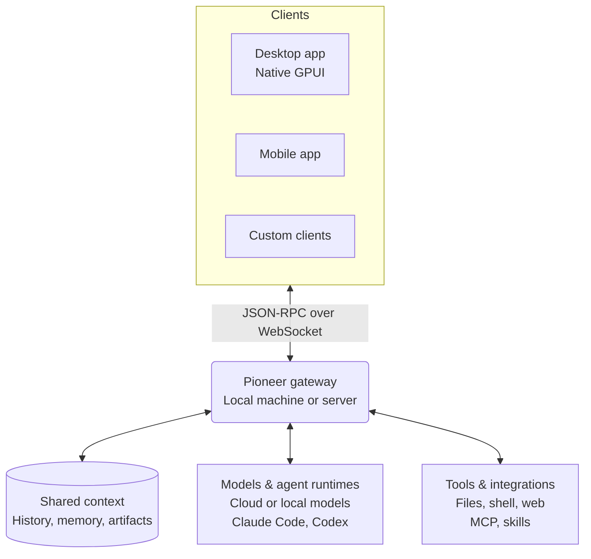

<p align="center">
  
</p>

<h1 align="center">Pioneer</h1>

<p align="center">
  Spaces where people and agents collaborate and build on shared context.
</p>

<p align="center">
  <a href="https://github.com/pioneerdotai/pioneer/releases"></a>
  <a href="./LICENSE"></a>
</p>

<p align="center">
  <a href="https://github.com/pioneerdotai/pioneer/releases">Download</a>
  ·
  <a href="https://docs.getpioneer.dev/getting-started/installation">Installation</a>
  ·
  <a href="https://docs.getpioneer.dev/getting-started/quickstart">Quick Start</a>
  ·
  <a href="https://docs.getpioneer.dev">Docs</a>
  ·
  <a href="https://docs.getpioneer.dev/architecture/overview">Architecture</a>
  ·
  <a href="https://docs.getpioneer.dev/protocol/introduction">Protocol reference</a>
</p>

<p align="center">
  <a href="README.md">English</a> · <a href="README.ru.md">Русский</a> · <a href="README.de.md">Deutsch</a> · <a href="README.es.md">Español</a> · <a href="README.fr.md">Français</a> · <a href="README.hi.md">हिन्दी</a> · <a href="README.ja.md">日本語</a> · <a href="README.zh-CN.md">简体中文</a>
</p>

Pioneer runs agents where you discuss the work. Talk in a thread, give an agent a task, and review its output in the same conversation. Use it on your own, with a team, or with your family.

Use Pioneer's built-in agents or connect Claude Code and Codex. Pioneer supplies context and tools and coordinates their tasks. Run it on your computer or a server you control.

<p align="center">
  <picture>
    <source media="(prefers-color-scheme: dark)" srcset="assets/screenshots/pioneer-main-dark.png">
    <source media="(prefers-color-scheme: light)" srcset="assets/screenshots/pioneer-main-light.png">
    
  </picture>
</p>

## What you can do

- **Investigate a bug together.** Share an error in a team thread. Ask an agent to inspect the code and logs, then review the proposed fix together.
- **Work on a launch.** Discuss the audience and constraints. Ask an agent to research competitors or draft copy, then give feedback.
- **Revisit a decision.** Ask why you chose an approach. An agent can search earlier discussions and use the relevant messages and linked files in its answer.
- **Plan something at home.** Discuss a trip with your family and ask an agent to compare options using your saved preferences.

## Features

| Feature | What it does |
| --- | --- |
| **Workspaces and threads** | Separate projects and groups. Invite people, exchange messages, and control access to workspaces and private threads. |
| **Agents and delegation** | Configure named agents, run tasks in the background, and let agents delegate work to subagents. Inspect progress and request revisions. |
| **Models and runtimes** | Use Anthropic, OpenAI, Gemini, OpenRouter, Ollama, or an OpenAI-compatible endpoint. Connect Claude Code or Codex on the gateway host. |
| **Tools and skills** | Work with files, shell commands, and the web. Connect services through [MCP](https://docs.getpioneer.dev/mcp/overview) and add reusable instructions through [skills](https://docs.getpioneer.dev/skills/overview). |
| **Scheduled work** | Set up one-off or recurring tasks and receive the results in a thread or the task inbox. |
| **Permissions** | Choose [Supervised, Auto-accept edits, or Full access](https://docs.getpioneer.dev/getting-started/permissions). The gateway enforces access and tool approval policies. |

## Build on shared context

The next task can use what you worked out in the previous one. Pioneer indexes conversation history, remembers selected facts and decisions, and keeps files linked to the tasks that produced them.

Agents retrieve relevant context within workspace and thread permissions and a bounded context budget. History and memory live in Pioneer, independently of your model provider.

[Memory](https://docs.getpioneer.dev/desktop/memory) · [Context retrieval](https://docs.getpioneer.dev/architecture/thread-episodic-context) · [Collaboration](https://docs.getpioneer.dev/desktop/account-and-collaboration)

## Get started

[Download Pioneer](https://github.com/pioneerdotai/pioneer/releases) for macOS, Windows, or Linux.

1. Open the app and start the local gateway when prompted, or connect to an existing gateway.
2. Choose a workspace and connect a model provider or supported agent runtime.
3. Start a thread. Invite other people when you want to work together.

[Quick start](https://docs.getpioneer.dev/getting-started/quickstart) · [Remote gateway installation](https://docs.getpioneer.dev/getting-started/installation)

## Under the hood

Pioneer is a Rust workspace with a native GPUI desktop app and a gateway backed by SQLite. Clients connect over a JSON-RPC WebSocket API.



The gateway owns state and runs model calls, CLI runtimes, tools, and scheduled tasks. A remote gateway uses that machine's files and execution environment. One desktop app can connect to multiple gateways.

[Architecture](https://docs.getpioneer.dev/architecture/overview) · [Protocol](https://docs.getpioneer.dev/protocol/introduction) · [Providers](https://docs.getpioneer.dev/providers/overview)

## Build from source

Install Rust with [rustup](https://rustup.rs). See [rust-toolchain.toml](./rust-toolchain.toml) for the toolchain and [Contributing](https://docs.getpioneer.dev/contributing) for platform dependencies.

```bash
git clone https://github.com/pioneerdotai/pioneer.git
cd pioneer
cargo update -p cua-driver-sdk
cargo build --workspace
```

Gateway releases provide a default server build and an opt-in computer-use build
for Windows, macOS and Linux on x86_64 and aarch64. `install.sh` and `install.ps1`
install the server build by default. Use `--headless` / `-Headless` to select it
explicitly, or `--computer-use` / `-ComputerUse` for computer use. The environment
variable `PIONEER_INSTALL_COMPUTER_USE=1` also selects computer use; an explicit
switch overrides it. Source builds enable it with `--features computer-use` on
`pioneer-cli` or `pioneer-gateway`; on macOS set `MACOSX_DEPLOYMENT_TARGET=13.0`
for those CU builds. Desktop bundles the computer-use variant.
Release packaging refreshes the SDK and fetches the current upstream driver
before building. Cargo.lock records the dependencies selected for that build.

The server assets retain their existing names and formats: gzip for Linux and
macOS aarch64, ZIP for Windows and macOS x86_64. Computer-use assets are named
`pioneer-gateway-{os}-{arch}-computer-use-package.zip` and contain the CUA driver built from the current upstream default branch
package. Install the complete CU archive; copying only `pioneer` cannot install
the driver. The installer keeps the executable and `bin/cua` together and retains
recovery files when schema compatibility is unknown.

Existing computer-use installations use their normal `pioneer update` or
`pioneer self-update` command. The old `-computer-use.gz` / `-computer-use.zip`
assets contain a compatibility executable with the complete new package embedded.
Its candidate version probe prepares a verified private package generation;
the existing updater retains schema admission, replacement and restart. The
bridge then runs the actual packaged Gateway, including its signed macOS app.
It requires no Desktop, manual script bootstrap or intermediate release. New
installers and subsequent updates select the complete `-computer-use-package.zip`
asset directly. Server asset names and formats remain unchanged. Use the existing
bootstrap with `--headless` / `-Headless` for an explicit switch back to server.
OS permission requests still belong to the Gateway machine; existing OS grants
are not promised to transfer automatically to the new responsible application.

The macOS computer-use package targets macOS 13.0 or later and runs
`Pioneer Gateway.app` (`ai.pioneer.gateway`) as the existing per-user GUI
LaunchAgent. Grant permissions to that signed Gateway app on the Gateway machine;
Desktop permissions do not authorize a remote Gateway. The server build does
not require the CUA app or its Swift build inputs. Its deployment policy follows
the existing server dependencies and toolchain, without a CUA-specific minimum.
Linux computer use needs a compatible graphical user session and capture/input
dependencies. Windows retains the current-user logon task with Limited
privileges; Linux retains the systemd user service. Actual binary dependencies,
minimum OS versions and computer-use readiness still require platform qualification.

Run these in separate terminals:

```bash
cargo run -p pioneer-gateway
cargo run -p pioneer-desktop --bin pioneer-app
```

Bug reports and pull requests are welcome. The [docs](https://docs.getpioneer.dev) cover the user guide, configuration, and architecture.

Pioneer is under active development; some flows are incomplete and APIs can change.

[MIT License](./LICENSE)
